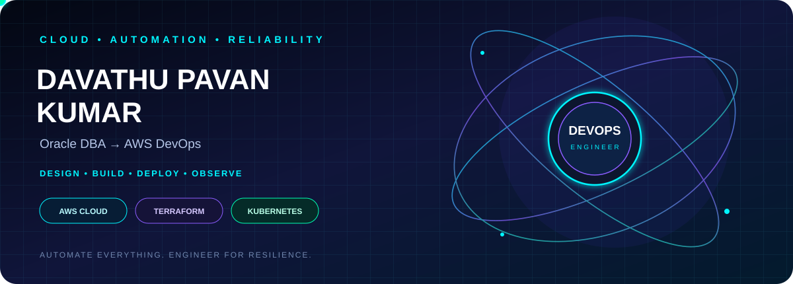
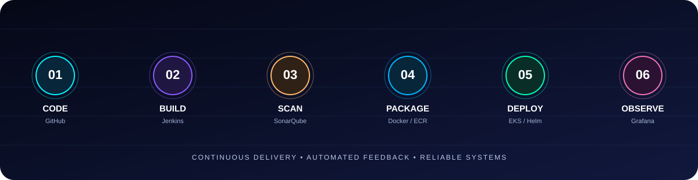

 

---

## `> whoami`

I'm **Davathu Pavan Kumar**, an Oracle DBA at Zensar Technologies with around five years of IT experience. I'm building on my database administration and production support background to grow deeper into AWS cloud, infrastructure automation, containers, CI/CD, and observability.

<table>
<tr><td width="50%" valign="top">

### ⚡ My foundation
- Oracle Database Administration
- RMAN backup and recovery
- Production troubleshooting
- Operational scripting
- Reliability-first thinking

</td><td width="50%" valign="top">

### 🚀 My DevOps direction
- AWS and cloud networking
- Terraform / Infrastructure as Code
- Docker and Kubernetes / EKS
- Jenkins and CI/CD
- Monitoring and automation

</td></tr>
</table>

---

## 🧬 Technology matrix

  

---

## 🌀 Pipeline in motion

---

## 🚀 Project lab

<table>
<tr>
<td width="50%" valign="top">

### ☁️ AWS + Terraform

- VPC, subnets, routing and security
- EC2, IAM and load balancers
- Reusable Terraform modules
- Repeatable infrastructure lifecycle

</td>
<td width="50%" valign="top">

### 🔁 CI/CD factory

- Git-based source control
- Automated builds and code checks
- Docker image build and push
- Repeatable delivery workflows

</td>
</tr>
<tr>
<td width="50%" valign="top">

### ☸️ Kubernetes / EKS

- Deploy containerized workloads
- Services and ingress
- Helm-based releases
- Scaling and rollout practice

</td>
<td width="50%" valign="top">

### 📡 Observability

- Metrics and dashboards
- Alerting concepts
- Incident troubleshooting
- Operational runbooks

</td>
</tr>
</table>

*These are project areas to build and showcase. Add repository links and verified implementation details as projects are completed.*

---

## 📊 GitHub command center

  

---

## 🐍 Contribution animation

---

## 🌌 Connect with me

  

**⚡ Automate boldly. Deploy reliably. Keep evolving.**

